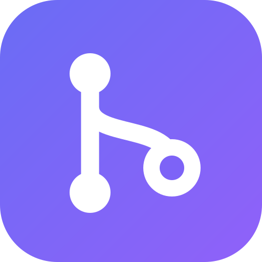
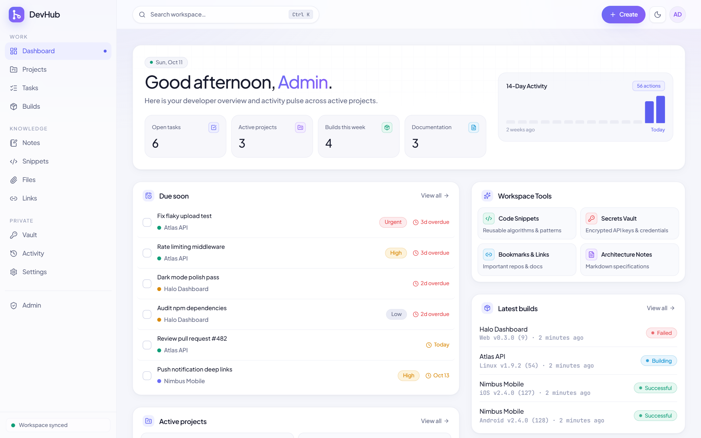
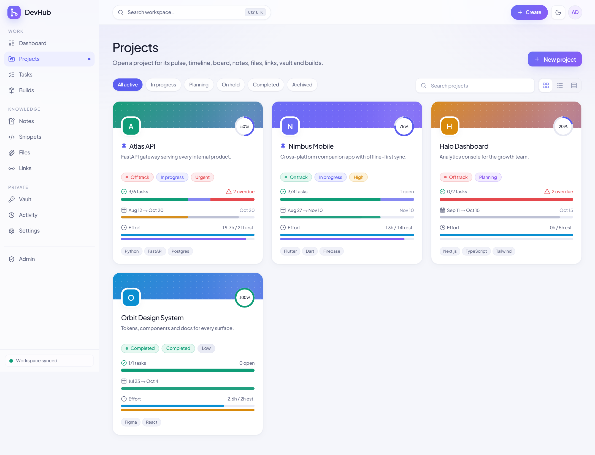
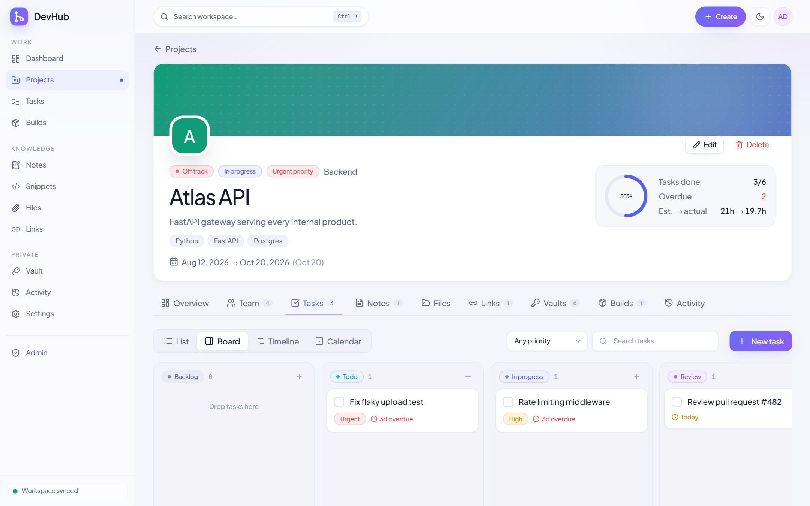
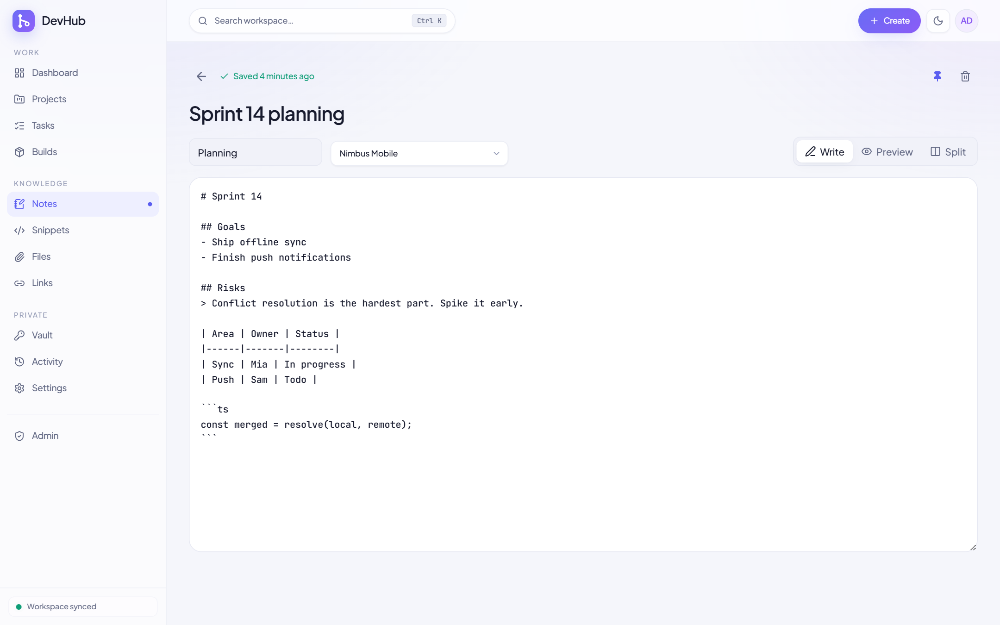
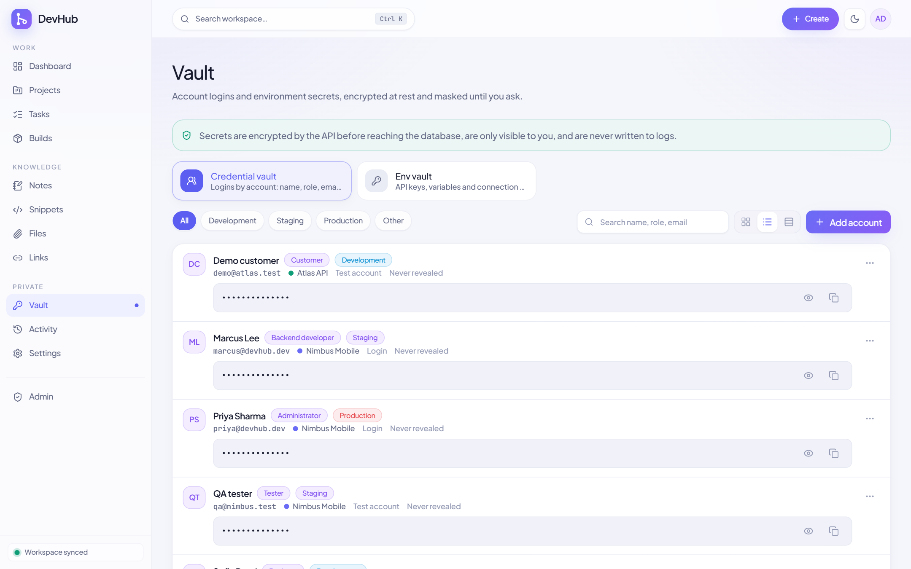
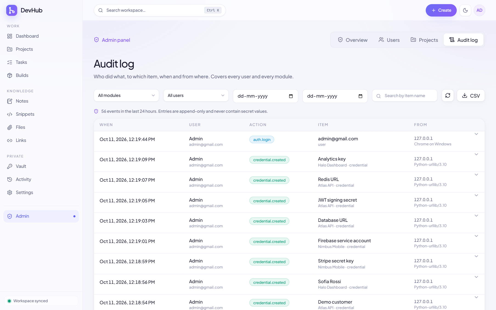
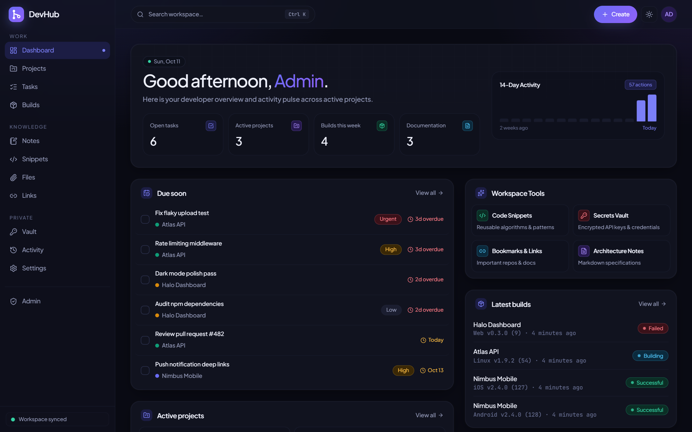

# DevHub

## Screenshots

<table>
  <tr>
    <td width="50%"></td>
    <td width="50%"></td>
  </tr>
  <tr>
    <td width="50%"></td>
    <td width="50%"></td>
  </tr>
  <tr>
    <td width="50%"></td>
    <td width="50%"></td>
  </tr>
</table>

## Features

| Capability | Highlights |
| :--- | :--- |
| **📊 Dashboard** | Personalized greeting, 14-day activity graph, Quick Tools widget, live health pulse, and active metrics. |
| **📁 Project Hub** | Group tasks, technical docs, links, files, and credentials under unified projects with progress indicators. |
| **✅ Task Management** | Switch between **Kanban Board**, **Grouped List**, **Timeline** and **Calendar** views. |
| **📝 Notes & Specs** | Split-pane Markdown editor, live formatting, code blocks, folder trees, and autosave. |
| **🧩 Snippet Manager** | Syntax-highlighted code bank with search across code bodies, language filtering, and 1-tap copy. |
| **🔐 Encrypted Vault** | Zero-knowledge secret storage with AES-256-GCM, auto-lock countdown (30s), and zero log persistence. |
| **📎 Cloud Files** | Direct uploads to Supabase Storage with progress bars, MIME categorisation, and 60-second signed URLs. |
| **🔗 Quick Links** | Intelligent URL bookmarks that auto-detect GitHub, Vercel, Supabase, Figma, and documentation endpoints. |
| **📦 Build Tracker** | Log releases with git branch, commit hash, platform target, artifact links, and changelog notes. |
| **🔎 Global Search** | Instant modal search with <kbd>Ctrl</kbd> / <kbd>⌘</kbd> + <kbd>K</kbd> across all projects, tasks, notes, and code. |

## Functions (CRUD & auditing)

| Module | Create | Read | Update | Delete | Audited |
|---|:--:|:--:|:--:|:--:|:--:|
| Projects (+ pulse) | ✅ | ✅ | ✅ | ✅ owner / admin | ✅ |
| Tasks | ✅ | ✅ | ✅ | ✅ | ✅ |
| Notes | ✅ | ✅ | ✅ | ✅ | ✅ |
| Files | ✅ | ✅ signed URLs | ✅ | ✅ | ✅ |
| Links | ✅ | ✅ | ✅ | ✅ | ✅ |
| Credentials vault | ✅ | ✅ masked, reveal logged | ✅ | ✅ | ✅ |
| Builds + artifacts | ✅ | ✅ | ✅ | ✅ | ✅ |
| Snippets & tags | ✅ | ✅ | ✅ | ✅ | ✅ |
| Users (admin only) | ✅ | ✅ | ✅ role / active / password | deactivate | ✅ |

## Roles

- **admin**: manages users, sees all projects and the audit log.
- **user**: works only inside their own or shared projects.
